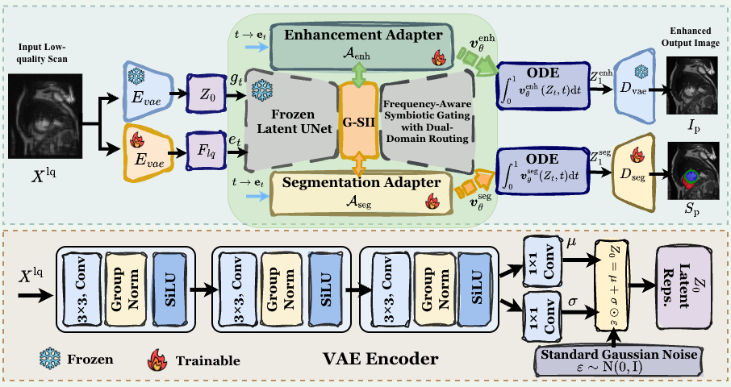

# LaSyNet: Latent Symbiosis for Joint Medical Image Enhancement and Segmentation

<p align="center">
  
</p>

This repository contains a reference PyTorch implementation of **LaSyNet** from the paper:

> **Latent Symbiosis: Adapter-Guided Diffusion Interaction with Gated Cross-Task Routing for Joint Medical Image Enhancement and Segmentation** (CVPR 2027 submission).

LaSyNet unifies medical image enhancement and segmentation into a single **Rectified-Flow** generative framework. A frozen latent UNet backbone is adapted via lightweight, task-specific **Adapters**, and an upgraded timestep- and frequency-aware **Gated Symbiotic Information Interaction (G-SII)** module dynamically routes bidirectional features between the two tasks.

---

## Key features

- **Rectified-Flow backbone** — straight-line ODE trajectory between noise and clean latent data instead of curved diffusion paths.
- **Adapter-guided PEFT** — only the task-specific adapters and projection layers are trained; the generative backbone can be kept frozen.
- **Upgraded G-SII** — FFT spectral stats for gating + TD-X discrepancy cues for cross-attention routing (`Seg → Enh` structure, `Enh → Seg` texture).
- **Robust L1 velocity supervision** — better preserves structural / anatomical boundaries than L2 regression.
- **Joint multi-task training** — simultaneous enhancement and segmentation with RF velocity-field losses plus pixel-space supervision.
- **Modality-specific degradation** — motion + Rician noise (ACDC/MRI), Poisson photon starvation (KiTS23/CT), and Gamma speckle (TN3K/ultrasound).

---

## Repository structure

```
LaSyNet/
├── configs/
│   └── default.yaml              # example configuration
├── lasynet/
│   ├── models/
│   │   ├── vae.py                # first-stage VAE/AE
│   │   ├── seg_encoder.py        # Flq encoder + mask encoder + segmentation decoder
│   │   ├── unet.py               # time-conditional UNet backbone
│   │   ├── adapter.py            # bottleneck adapters
│   │   ├── gsii.py               # upgraded frequency-aware G-SII (+ TD-X)
│   │   └── lasynet.py            # full model + RF training/inference logic
│   ├── data/
│   │   ├── datasets.py           # ACDC, KiTS23, TN3K data loaders
│   │   └── degradation.py        # modality-specific artifact injection
│   └── utils/
│       ├── config.py             # YAML helpers
│       └── metrics.py            # PSNR, SSIM, Dice, mIoU
├── train.py                      # training script
├── eval.py                       # evaluation script
├── requirements.txt
└── README.md
```

---

## Installation`

### create a fresh `lasynet` environment

```bash
git clone <repo-url>
cd LaSyNet
conda env create -f environment.yml
conda activate lasynet
```

Or with pip:

```bash
conda create -n lasynet python=3.10
conda activate lasynet
pip install -r requirements.txt
```

> The implementation uses PyTorch only. `nibabel` is optional and only required for 3D NIfTI datasets (ACDC / KiTS23).

---

## Data preparation

### TN3K (2D thyroid ultrasound)

```
data/TN3K/
├── train/
│   ├── images/
│   └── masks/
└── test/
    ├── images/
    └── masks/
```

Masks should be binary PNGs (`0` = background, `255` or `>0` = foreground).

### ACDC / KiTS23 (3D volumes)

Provide text files listing absolute paths to the NIfTI images and masks:

```yaml
train_images: /path/to/acdc_train_images.txt
train_masks:  /path/to/acdc_train_masks.txt
test_images:  /path/to/acdc_test_images.txt
test_masks:   /path/to/acdc_test_masks.txt
cache_volumes: true
```

---

## Training

```bash
python train.py --config configs/default.yaml --output_dir checkpoints/tn3k
```

Resume:

```bash
python train.py --config configs/default.yaml --output_dir checkpoints/tn3k --resume checkpoints/tn3k/checkpoint_epoch_010.pt
```

Quick smoke test on synthetic data:

```bash
python train.py --config configs/demo.yaml --output_dir checkpoints/demo
```

Key hyperparameters in `configs/default.yaml`:

| Parameter | Meaning |
|-----------|---------|
| `beta` | Weight of the segmentation RF loss (`β = 1.0` in the paper) |
| `lambda_seg` | Weight of the pixel-space segmentation loss (`λ = 0.5`) |
| `freeze_backbone` | If `true`, only adapters / G-SII / decoders are trained |
| `num_steps` | Euler ODE steps at inference (paper uses 25) |
| `seg_downsample_steps` | Must equal `len(vae_channel_mult) - 1` (VAE spatial factor) |

---

## Evaluation

```bash
python eval.py --config configs/default.yaml --checkpoint checkpoints/tn3k/checkpoint_epoch_100.pt --output_dir outputs/tn3k
```

Override ODE steps:

```bash
python eval.py --config configs/default.yaml --checkpoint ... --output_dir outputs/tn3k --num_steps 10
```

Metrics are saved to `outputs/tn3k/metrics.json`.

---

## Using a pretrained diffusion backbone

The default VAE and UNet are small trainable networks for demonstration. To match the paper more closely, replace the default `Autoencoder` with a pretrained medical/stable-diffusion VAE and set `freeze_backbone: true` after loading a pretrained UNet into `models/lasynet.py`. The interface is:

```python
z = model.vae.get_latent(x)      # deterministic latent encoding
x_hat = model.vae.decode(z)      # decode to image space
v = model.backbone(z_t, t, adapters)  # velocity field
```

The `LaSyNet` constructor will automatically create the right number of adapters for every ResBlock of the supplied UNet.

---

## Implementation notes

- This is a **reference implementation** of the CVPR method. Paper numbers use a large pretrained latent diffusion backbone and full training on ACDC, KiTS23, and TN3K.
- G-SII implements frequency-aware gating (Eq. 6) and TD-X discrepancy-aware cross-attention (Eqs. 7–10).
- RF branches are trained with **L1** velocity regression; enhancement uses pixel MSE and segmentation uses weighted BCE / CE.
- Inference uses a deterministic forward Euler ODE solver (`S = 25` by default).

---

## Citation

```bibtex
@inproceedings{chen2027lasynet,
  title={Latent Symbiosis: Adapter-Guided Diffusion Interaction with Gated Cross-Task Routing for Joint Medical Image Enhancement and Segmentation},
  author={Anonymous},
  booktitle={arix},
  year={2027}
}
```

---

## License

This code is released for academic/research purposes. Please refer to the original paper and dataset licenses before using the model clinically.
